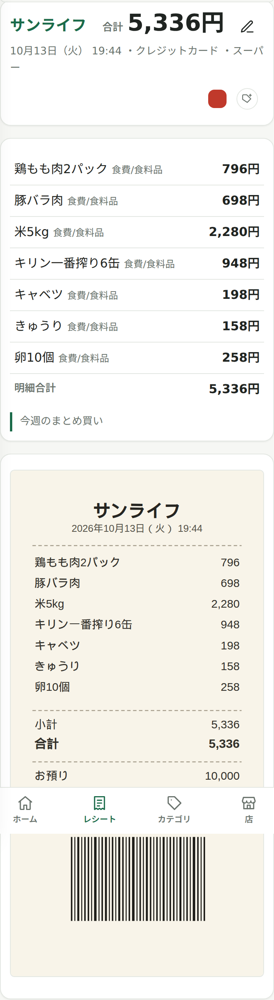
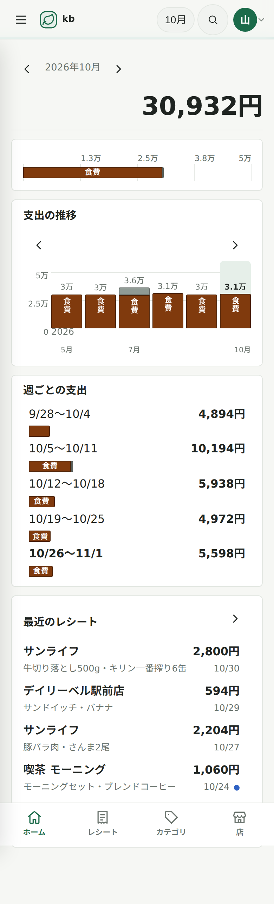

# kakeiboot

家計簿をつけようとして続かなかったことはないだろうか。理由はたいてい同じで、レシートの数字をいちいち手で打ち込むのが嫌になるのだ。

kakeibootではその打ち込みが存在しない。レシートを撮って ChatGPT に送れば店名も日付も品物も値段も写真から読み取られて記録される。

<p></p>

1か月ふつうに買い物をして月末にこの画面を開く。

<p></p>

食費もよく行く店も品物の値段の動きも勝手にまとまっている。

レシートを1枚撮って送る、それだけの家計簿。

招待 URL から始められる。手順は登録後に web 画面の「使い方」にあります。

## 開発

必要なもの: Rust（stable、edition 2024）、Node.js、pnpm、mise。

```bash
mise run frontend:install
mise run dev
mise run verify
```

詳細は [docs/dev/dev_setup.md](docs/dev/dev_setup.md)、文書の索引は [docs/README.md](docs/README.md)、使い方の本文の正本は [docs/usage/README.md](docs/usage/README.md) を参照。
