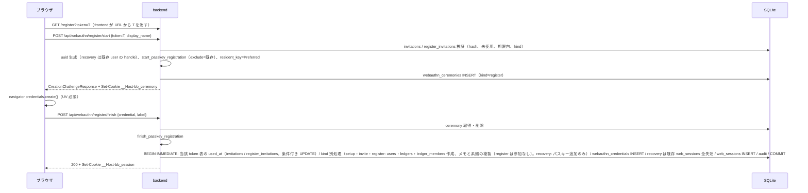
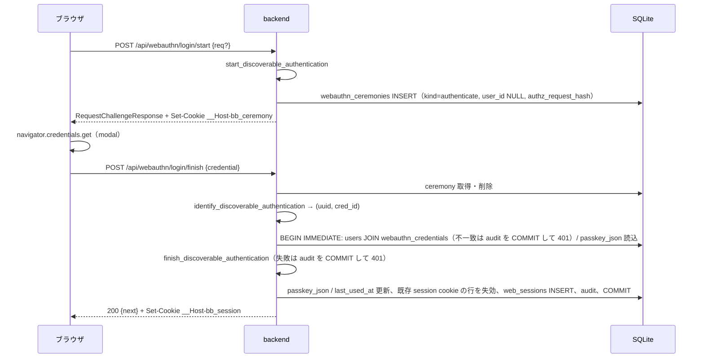
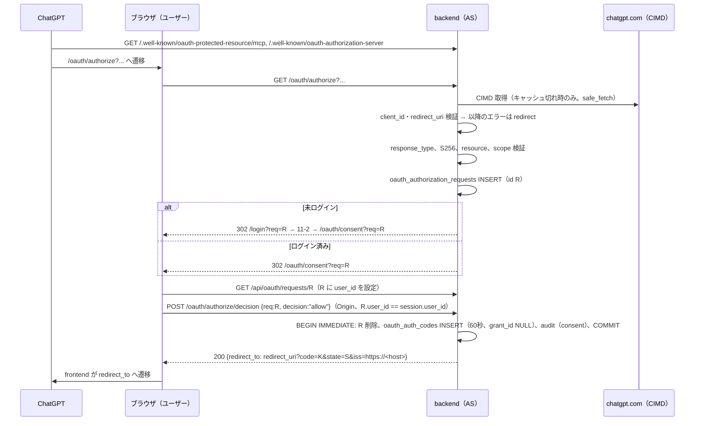
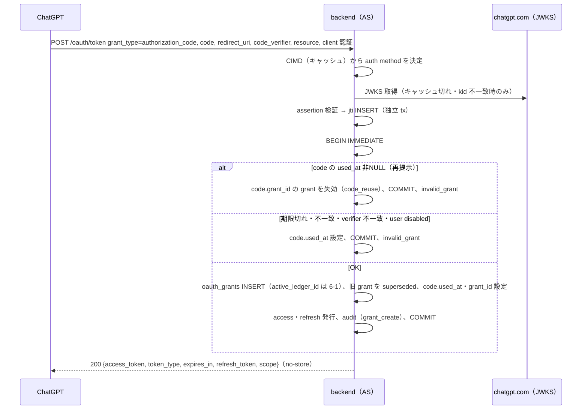
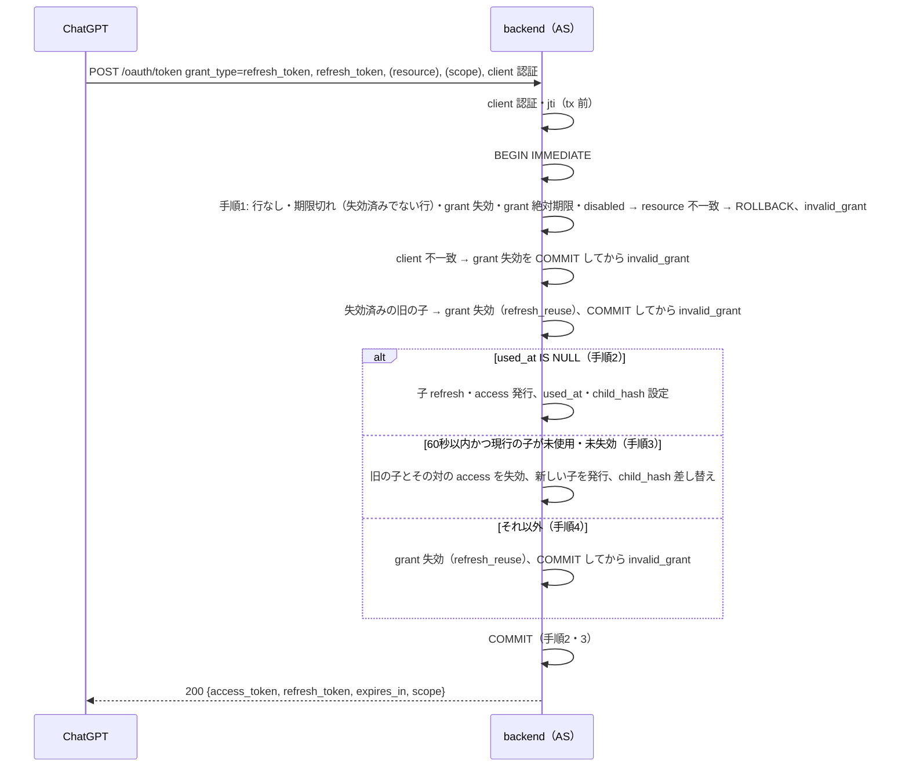
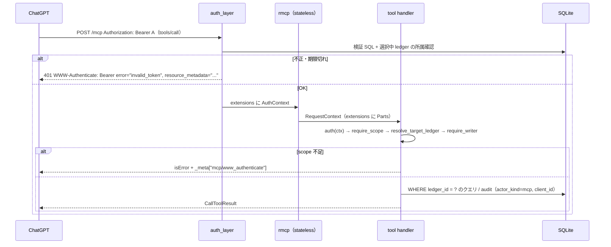

# 仕様: 認証・認可

budget-book の認証・認可の正本。パスキー（WebAuthn）による登録・ログイン・回復、web セッション、MCP クライアント向け OAuth 2.1 認可サーバー、MCP リソースサーバーでの Bearer 検証と ledger の解決、アカウント特定と回復依頼、運用者 CLI、セキュリティ規則を定める。テーブル構造・制約・TTL は `spec_data-model.md` を正とし、本書は振る舞いを定める。

## 1. 全体構成

backend（Rust / axum）が次の3役を1プロセス・単一 origin で担う。

| 役割 | 内容 | 主なパス |
|---|---|---|
| WebAuthn Relying Party | パスキー登録・ログイン・step-up、web セッション発行 | `/api/webauthn/*`、`/api/passkeys*`、`/api/auth/*`、`/api/invitations`、`/api/register-invitations` |
| OAuth 2.1 認可サーバー | CIMD によるクライアント識別、認可コード + PKCE、token 発行・refresh rotation・失効 | `/.well-known/oauth-authorization-server`、`/oauth/*`、`/api/oauth/*` |
| MCP リソースサーバー | Bearer 検証、scope / role 検査、tool 実行 | `/.well-known/oauth-protected-resource[/mcp]`、`/mcp` |

固定値（正本は `configs/<env>/auth.toml`）:

| 項目 | 値 |
|---|---|
| 公開 origin | `https://<host>`（cf-tunnel 経由。web 画面・API・OAuth・MCP を同一 host に同居） |
| issuer | `https://<host>`（パスなし、末尾スラッシュなし） |
| MCP canonical URI（resource） | `https://<host>/mcp`（末尾スラッシュなし） |
| WebAuthn RP ID / origin | `<host>` / `https://<host>` |
| frontend 配信 | backend が Vite build 成果物を同一 origin で配信。開発時は Vite dev server の proxy で同一 origin に見せる |
| MCP クライアント | ChatGPT・Claude（CIMD の client_id host を `chatgpt.com`・`claude.ai` に限定。Claude は TASK-149 で追加） |

- 同一 origin 前提により cookie は `__Host-` prefix・`SameSite=Lax` とし、CORS は一切設定しない。
- サーバーが保持する秘密鍵・共有 secret は初版に存在しない（opaque token + hash 保存、WebAuthn は公開鍵のみ保存、署名付き token を発行しない）。
- 環境別の RP 設定は環境別ディレクトリ `configs/<env>/auth.toml`（`[auth.env.<env>]`）で持つ。dev は `rp_id = "localhost"`、`rp_origin = "http://localhost:<Vite の port>"`（ブラウザが見る origin）。stg は `https://kakeiboot-stg.scioj.com`、prod は `https://kakeiboot.scioj.com`。
- 起動時に設定を検証する（issuer と resource の scheme/host 一致、RP ID が origin の host と一致、末尾スラッシュなし等）。不一致なら起動失敗。

## 2. アカウントとパスキー

### 2-1 登録の入口

登録は招待制とし、オープン登録は持たない。登録用の1回限り token は `invitations`（setup / invite / recovery）と `register_invitations`（register）に保存する（256bit 乱数、DB は SHA-256 hash、平文は1回だけ表示）。

| kind | 発行者 | 既定 TTL | できること |
|---|---|---|---|
| `setup` | 運用者 CLI（`admin token issue --kind setup --note`） | 24時間 | 新規 user と個人 ledger の作成 |
| `invite` | 対象 ledger の owner が web 画面から（対象 ledger は発行時に選択。TASK-78） | 168時間（`invite_ttl_hours`。TASK-46） | 新規 user と個人 ledger の作成 + 招待元 ledger への参加（role は editor / viewer）。新規発行は参加チケット（2-1A）へ移行済みで、本行の受理は移行期間のみ |
| `recovery` | 運用者 CLI（`admin token issue --kind recovery` / `admin recovery resolve`） | 1時間（`--ttl` で最大24時間） | 対象 user へのパスキー追加のみ |
| `register`（保存は `register_invitations` 表） | アクティブ user が web 画面から（メモ必須） | 168時間（`register_ttl_hours`。TASK-46） | 新規 user と個人 ledger の作成（家計簿への参加を伴わない） |

- invite の対象 ledger は発行時に選ぶ（自分が owner の ledger のみ。無指定なら発行者の既定 ledger）。web 画面（設定の認証tab）での呼称: invite の発行 UI は「家計簿を共有」の共有語（対象家計簿名は発行 dialog で明示）とし、register の発行 UI を「登録の招待」とする。UI で「招待」の語を使うのは register のみ。

- URL は `https://<host>/register?token=<T>`。frontend は URL から token を読んだ直後に `history.replaceState` で消し、以降は POST body で送る。
- 未使用の register token は発行者ごとに5本まで（超過時 400 `register_open_limit`）。
- register の inviter_note は必須・200文字まで。
- register の発行は `POST /api/register-invitations`（invite とは別 endpoint）。
- invite で登録した user も個人 ledger を持つ。`default_ledger_id` は常に個人 ledger とする。登録画面に既定の選択肢は置かず、`register/finish` の `use_invited_ledger_as_default` は互換のため受理するがサーバーは無視する（2-1A の分離に伴う変更。既定の変更は設定画面の `PUT /api/auth/me/default-ledger` のみ）。
- 受理 API は kind ごとに許可操作を分ける。recovery では user・ledger の作成、表示名の入力・変更、grant の変更を受け付けない。
- 同じ user の未使用 recovery token は常に1本（発行時に既存の未使用 token を行削除してから INSERT）。
- `users.disabled_at` が非 NULL の user はログイン・回復・招待受諾をすべて拒否する。

### 2-1A 家計簿の共有（参加チケット）

共有（membership の付与）と登録（identity の作成）は分離する。家計簿への参加は登録トークンではなく、専用の参加チケット（`ledger_share_tickets`、256bit 乱数、DB は SHA-256 hash、平文は1回だけ表示）で行う。テーブル構造は `spec_data-model.md` §14・§15（0013）を正とする。

- 発行: 対象 ledger の owner が web 画面から（`POST /api/share-tickets`、`{ledger_id, role, inviter_note?}`。role は editor / viewer、メモは任意・200文字まで）。TTL は168時間（`share_ttl_hours`）。URL は `https://<host>/share?token=<T>`。frontend は token を同一タブの `sessionStorage`（`kb_share_token`）へ退避してから URL から消し、以降は POST body で送る。開封・照会では消費しないため、タブを閉じた場合は元の URL から開き直せる。
- 照会: `POST /api/share/info` は認証任意。open なチケットについて家計簿名・role・発行者表示名・期限と、セッションがある場合はその表示名と所属済みかを返す。不存在・期限切れ・受諾済みは同一視して 400 `invalid_token` とする。照会はチケットを消費しない。
- 受諾: `POST /api/share/accept` は web セッション必須（未ログインは 401 で、チケットは消費しない）。ログインした本人が画面で「参加する」を押したときにだけ、`BEGIN IMMEDIATE` 内で `accepted_at` / `accepted_by` の条件付き UPDATE（`accepted_at IS NULL AND expires_at > now`）により消費し、同じ tx で `ledger_members` への所属付与と audit（`entity_type=share_ticket`、`action=share_accept`）を行う。消費点は受諾の1か所だけ。
- 所属付与の規則: 既存メンバーでない場合はチケットの role で参加する。既存メンバーで既存 role がチケットより弱い場合は格上げのみ行い、強い場合は変更しない（格下げはしない）。既に自分が受諾済みのチケットの再送は `already_member` として冪等に成功する。受諾は `users.default_ledger_id` と grant の `active_ledger_id` を変更しない。受諾時点で発行者の権限は再検査しない（チケットは発行時点の owner の委任として期限まで有効）。
- 対象者は登録済み user のみとする。未登録者向けに共有 URL から登録へ橋渡しする経路は持たない（登録は register / setup の招待で別に行う）。受諾画面に登録への言及は置かず、アカウントを持たない受領者を画面から登録へ誘導しない。チケットは消費しない。
- 受諾画面の提示: 情報は優先順に並べる。先頭は招待として読める文（「{発行者} さんが家計簿を共有しました」。発行者はこの文に組み込み、独立した項目にしない。見出しは行のバランスを取って改行し、文の途中で不自然に折らない）。次に対象の家計簿を、文字の列ではなく1つの視覚パネルとして出す（家計簿のマーク＋名前。種別などの説明ラベルは置かない。名前は1つの単位として扱い、空白・句読点でのみ改行し、単語の途中で割らない）。権限は項目名＋値の表ではなく、役割そのもの（editor は「編集」、viewer は「閲覧のみ」）を家計簿マークの隅に重ねた小さなバッジで示し、独立した行は取らない。受諾のボタンは結果がそのまま分かる文言（「この家計簿を追加する」）とし、「参加」のような抽象語は画面に出さない。期限は最下部に「{日付} まで有効」と日付のみ（時刻は出さない）小さく静かに右揃えで出す。操作部は2段の固定配置とし、第1段はログイン前後で同じ形のアカウントバー（ログイン済みはアバター＋表示名、未ログイン時はバー自体がログイン操作を兼ねる。「ログイン中」のような状態を表す文は置かない）、第2段は常に追加ボタン（未ログイン時は無効状態で同じ位置に置く）として、状態でボタンの位置が動かないようにする。権限・発行者・期限を項目表（kv）でベタ書きしない。受諾画面の状態遷移（読込→提示→完了）はフェード＋僅かな縦移動でつなぎ、完了マークはポップで出す。発行側の一覧（発行直後の URL 行・発行済みチケット行）もフェードで出し入れする。prefers-reduced-motion では即時。
- 一覧・失効: 発行者は `GET /api/share-tickets` で自分の未受諾チケットを一覧でき、`DELETE /api/share-tickets/{ticket_ref}`（ticket_ref は token hash の先頭8 hex。認証要素としては使わない）で失効（行削除 + audit）できる。平文 URL は発行時にしか表示されない。
- 互換: `POST /api/invitations` は移行期間中、共有チケット発行へ委譲し `/share?token=…` 形式の URL を返す。旧形式 invite（`/register?token=…`）の受理は移行期間（新規 backend のデプロイから7日）だけ残し、その後は受理コードごと削除する。admin CLI の token 一覧・失効は `ledger_share_tickets` も横断対象とする。

### 2-2 ユーザー識別

- ログイン ID（ユーザー名・email）は持たない。user は表示名と discoverable credential の user handle で識別する。
- WebAuthn の `user.name` は「表示名 + ` (budget-book)`」、`user.displayName` は表示名。
- user handle（`users.webauthn_user_handle`）は UUID v4（16byte、webauthn-rs の user unique id）。内部 ID は WebAuthn に露出しない。新規 user 登録では register/start の challenge に載せた uuid を finish 時にそのまま保存する（discoverable credential はログイン時に常にこの challenge handle を返すため、保存値が異なると認識できなくなる。2026-10-17 修正）。
- user 作成時にアカウント番号（8 節）を付与する。

### 2-3 パスキー登録

- `start_passkey_registration(uuid, name, display_name, exclude_credentials = 当該 user の既存 credential 全件)` を呼び、返された `authenticator_selection.resident_key` を `Preferred`（`requireResidentKey=false`）に上書きし、`userVerification=required` とし、passkey API 既定の拡張（credProt / uvm / credProps）を除去してから送る。`Required` は一部クライアントで端末・クラウドのパスキー（iCloud キーチェーン / Google パスワードマネージャー等）を選択肢から隠したため（TASK-7 実機確認）。これらのパスキー提供元は discoverable credential を作成するため、ボタンからのログイン（2-4）は成立する。
- user verification は常に required（webauthn-rs passkey API の既定）。attestation は none。authenticator の機種制限はしない。
- 新規 user 登録（setup / invite / register）の finish では、start の challenge に載せた uuid（ceremony の envelope に保持）を `users.webauthn_user_handle` として保存する。recovery と settings からの追加は既存 user の handle を使うため影響しない。
- ラベル（`webauthn_credentials.label`）は登録時にユーザー入力、未入力なら User-Agent 由来の既定名。
- 登録完了の tx（`BEGIN IMMEDIATE`）で、当該 token 表（`invitations` / `register_invitations`）の `used_at` を条件付き UPDATE で設定（二重使用防止）し、kind 別処理・`webauthn_credentials` INSERT・新 web session 発行・audit を行う。recovery の場合は当該 user の既存 web session をすべて失効させる（既存パスキーと OAuth grant は変更しない）。

### 2-4 ログイン

- discoverable 認証のみ（`start_discoverable_authentication`）。frontend は modal の「パスキーでログイン」ボタンのみを置く（autofill 経由の conditional UI は使わない）。
- finish: `identify_discoverable_authentication` で (uuid, credential_id) を得て、次の SQL で credential_id により user を解決する（`credential_id` は UNIQUE で user と 1:1）。行なし（未登録・無効化）はすべて同じ 401 とし、audit に `login_mismatch` を記録する。提示された user handle と `users.webauthn_user_handle` の一致は必須としない（2026-10-16 以前に初回登録した credential は challenge handle とは別の uuid が保存されており、handle 一致を要求すると恒久的にログインできない）。handle が不一致でもログインは成功し、audit の `login` 行の after_json に `user_handle_match: false` を記録して可視化する。本人検証は引き続き `finish_discoverable_authentication` の署名検証（challenge・origin・署名・counter）が担う。

```sql
SELECT u.id, u.webauthn_user_handle
FROM users u JOIN webauthn_credentials c ON c.user_id = u.id
WHERE c.credential_id = :cred_id AND u.disabled_at IS NULL;
```

- credential_id による user 解決以降（user 解決 SQL、当該 user の `passkey_json` 読み込み、`finish_discoverable_authentication`、`update_credential` が Some なら `passkey_json` 更新、`last_used_at` 更新、既存 session cookie の失効、session 発行、audit）は 1 つの `BEGIN IMMEDIATE` で行う。counter 検証は write lock の下で読んだ最新の保存値を基準とし、同一 credential の並行ログインでも保存 counter は単調増加し（巻き戻らない）、同一または逆行した counter の assertion は後から write lock を得た側が `counter_regression` で拒否される。検証失敗・mismatch の audit も同じ tx に書き、COMMIT した後に 401 を返す（COMMIT 自体が失敗した場合は 500）。ceremony の取得・削除と `identify_discoverable_authentication` は tx の前に行う（identify 失敗の `login_mismatch` audit は tx の外で記録する）。tx 内では別の DB 接続を取得しない。user の無効化（運用者 CLI `user disable`）は無効化と同じ tx で既存 session を失効させるため、無効化の直前に完了したログインの session も失効する。
- sign counter の逆行（保存値 > 0 かつ受信値 <= 保存値）は webauthn-rs の拒否に従いログイン失敗とし、audit に `counter_regression`（credential id 付き）を記録する。credential の自動無効化はしない。counter 逆行以外の検証失敗（署名不正・origin 不一致等）も同じ 401 とし、audit には `login_failed`（error 文言を after_json に含む）を記録する。複数タブ等で counter を持つ authenticator の assertion が生成順と逆に到着した場合も同じ規則で後から write lock を得た側を拒否する（利用者は再試行する）。counter が 0 固定の authenticator（同期パスキー）は counter 検査の対象外で、並行ログインはいずれも成功する。
- backup eligible / backup state の変化は拒否せず `passkey_json` を更新し、一覧で「同期済み / 端末内」を表示するのみ。
- ログイン成功のたびに新しい session 行を発行する。リクエストに既存の session cookie があれば、その行は user に関わらず失効させる。
- OAuth の途中でログインした場合、ログイン開始時に frontend が URL の `req`（authorization request ID）を送り、backend は hash して存在確認のうえ `webauthn_ceremonies.authz_request_hash` に保存する。完了時は `{next: "consent"}` だけを返し、frontend は保持している平文 `req` で `/oauth/consent?req=<R>` へ遷移する（任意 URL への遷移経路を持たない）。

### 2-5 ceremony 状態

- webauthn-rs の `PasskeyRegistration` / `DiscoverableAuthentication` / `PasskeyAuthentication` を `webauthn_ceremonies.state_json` に保存する（feature `danger-allow-state-serialisation`。state はサーバー DB にのみ置く）。
- ceremony ID（256bit）は `__Host-bb_ceremony` cookie（HttpOnly, Secure, SameSite=Strict, Max-Age=300, Path=/）で発行し、finish 時に cookie から取り出して1回使用で削除する。TTL 5分。
- ログイン中に行う ceremony（step-up・パスキー追加）は `webauthn_ceremonies.user_id` にセッションの user_id を保存し、finish 時に `ceremony.user_id == session.user_id` を検査する（不一致は 403、ceremony は削除）。

### 2-6 step-up 再認証

- 対象操作: パスキーの削除のみ（TASK-46 で追加・発行系からは外れた。条件は直近 10分以内のパスキー認証 `web_sessions.auth_at`）。
- 満たない場合は 401 `{"error":"reauth_required"}` を返し、frontend が modal のパスキー認証を行ってから再送する。
- step-up は非 discoverable 認証（`start_passkey_authentication(当該 user の credential 全件)`）とし、他 user のパスキーで step-up できないようにする。成功時は同じ session 行の `auth_at` を更新する。
- finish では、ceremony の取得・削除・user 一致検査と `finish_passkey_authentication`（開始時 snapshot による署名検証）を transaction の外で行い、それ以降（credential の所有確認、当該 user の `passkey_json` 読み込み、sign counter の再判定、`update_credential` が Some なら `passkey_json` 更新、`last_used_at` 更新、`auth_at` 更新）は 1 つの `BEGIN IMMEDIATE` で行う。tx 内では別の DB 接続を取得しない。`auth_at` 更新の影響行数が 0（tx 取得後に session が削除された）なら credential 更新もろとも rollback して 401 を返す。ceremony の消費は原子（1回限り。並行する同一 ceremony への再提出は2回目以降が受理されない）。
- counter 検証は write lock の下で読んだ最新の保存値を基準とする（`(受信値 > 0 または 保存値 > 0)` かつ `受信値 <= 保存値` なら拒否）。ceremony TTL 内に別の login・step-up で保存 counter が進んだ場合、開始時 snapshot の基準を満たす assertion でも後から write lock を得た時点の保存値に対して逆行していれば `counter_regression` として 401 を返す（§10-5 の WARN 粒度）。これにより同一 credential の並行 login・step-up で保存 counter が巻き戻らず、遅延到着した step-up assertion は再生できない。counter が 0 固定の authenticator は検査対象外で、並行でも誤拒否しない。
- step-up 失敗時の log は WARN のみで audit_events への挿入は行わない（§10-5 の「audit_events 挿入に併記」の例外。失敗は利用者側の再試行で回復する一時的な状態のため）。

### 2-7 パスキー管理

- 設定画面から追加・一覧・改名・削除。削除は step-up 必須（追加は不要。TASK-46）。追加は「パスキーを追加」button から小さな dialog で名前を入力して行う（常設の入力欄は持たない）。
- web 画面では最後の1本は削除不可（409）。
- 2本目のパスキーを勧める表示は出さない。

### 2-8 紛失時の回復

- 主: パスキーの自動同期（iCloud キーチェーン / Google パスワードマネージャー）。端末紛失・機種変更は同期で吸収する。
- 同期アカウントごと失った等の場合: ユーザーが運用者に連絡し、運用者が帯域外で本人確認したうえで CLI でパスキー再登録 URL（recovery token）を発行する。URL の受け渡しは運用者とユーザーの直接連絡で行い、アプリはメール等で送らない。
- 再登録でできるのはパスキーの追加のみ。完了時に当該 user の既存 web session をすべて失効させる。既存パスキーは自動で消さず（運用者が CLI で失効、またはユーザーが設定画面で削除）、OAuth grant も失効させない。
- 回復コード、2本目のパスキーの推奨表示、ChatGPT subject による回復は持たない。
- ChatGPT が tool 呼び出しの `_meta` に付ける `openai/subject` 等の利用者識別子は、認可判断（user の特定・ledger の選択・回復 URL の発行）に使わない。user は Bearer token から解決した値だけを正とする。

## 3. web セッション

- サーバー側セッション。cookie: `__Host-bb_session=<256bit base64url>; Path=/; Secure; HttpOnly; SameSite=Lax`（Max-Age は絶対期限まで）。DB には SHA-256 hash を保存する。

| 項目 | 値 |
|---|---|
| idle 期限 | 14日 |
| 絶対期限 | 30日 |
| step-up | 直近 10分以内の認証（`auth_at`） |
| `last_seen_at` / `idle_expires_at` の更新 | 前回更新から 5分以上経過時のみ |

- 検証 SQL は `users.disabled_at IS NULL` を JOIN 条件に含める。
- ログアウト: `POST /api/auth/logout` は当該 session に `revoked_at` を設定し cookie を `Max-Age=0` で消す。`POST /api/auth/logout-all` は当該 user の全 session を失効（OAuth grant は対象外）。
- 回復（再登録完了）・ユーザー無効化では全 session を失効させる。

### 3-1 CSRF 対策

- 状態変更リクエスト（POST/PUT/PATCH/DELETE）は `Origin` ヘッダが公開 origin と完全一致することを必須とする（無い・不一致は 403）。対象は `/api/*` と `/oauth/authorize/decision`。`/oauth/token`・`/oauth/revoke` は cookie を使わないため対象外。
- `/api/*` は `Content-Type: application/json` のみ受理する。
- 同意の決定 POST は authorization request ID を body に含め、その request がセッションの user に紐付いていることを確認する。

### 3-2 web 認証 API（すべて JSON、Origin 検証）

| メソッド・パス | 入力 | 成功 |
|---|---|---|
| `POST /api/webauthn/register/info` | `{token}`（受付画面用の最小情報。token は URL query でなく body で受け取る） | 200 `{kind, needs_display_name, ledger_name?, role?, user_display_name?}` |
| `POST /api/webauthn/register/start` | `{token, display_name?}`（setup / invite / recovery。recovery は display_name を受け付けない） | 200 CreationChallengeResponse + ceremony cookie |
| `POST /api/webauthn/register/finish` | `{credential, label?, use_invited_ledger_as_default?}` | 200 + session cookie |
| `POST /api/webauthn/login/start` | `{req?}` | 200 RequestChallengeResponse + ceremony cookie |
| `POST /api/webauthn/login/finish` | `{credential}` | 200 `{next}` + session cookie |
| `POST /api/webauthn/reauth/start` / `finish` | session | 200（`auth_at` 更新） |
| `POST /api/passkeys/start` / `finish` | session（TASK-46 で step-up 廃止） | 200 |
| `GET /api/passkeys` | session | `[{id, label, created_at, last_used_at, backup_state}]` |
| `PATCH /api/passkeys/{id}` | session、`{label}` | 200 |
| `DELETE /api/passkeys/{id}` | session + step-up | 204 / 409（最後の1本） |
| `POST /api/invitations` | session、対象 ledger の owner（`ledger_id` で指定。無指定は既定 ledger。TASK-78）、`{role, ledger_id?, inviter_note?}` | 201 `{url, expires_at}`（URL は1回だけ返す。対象が editor 以下なら 403 `owner_required`・非所属/不在は 404） |
| `POST /api/register-invitations` | session（全アクティブuser）、`{inviter_note}`（必須・200文字まで） | 201 `{url, expires_at}`（URL は1回だけ返す） |
| `POST /api/share-tickets` | session、対象 ledger の owner、`{ledger_id, role, inviter_note?}` | 201 `{url, expires_at}`（URL は `/share?token=…` で1回だけ返す。非所属は 404、owner でない所属は 403 `owner_required`） |
| `GET /api/share-tickets` | session | 200 `[{ticket_ref, ledger_id, ledger_name, role, created_at, expires_at, inviter_note}]`（自分の未受諾・期限内のチケット。平文は含めない） |
| `DELETE /api/share-tickets/{ticket_ref}` | session（発行者本人のみ） | 204（行削除 + audit。他人の ref は 404） |
| `POST /api/share/info` | 任意（session があれば付加情報を返す）、`{token}` | 200 `{ledger_name, role, issuer_display_name, expires_at, session, already_member}`（それ以外は一律 400 `invalid_token`） |
| `POST /api/share/accept` | session、`{token}` | 200 `{ledger: {id, name, role}, outcome}`（`outcome` は `joined` / `already_member`。未ログインは 401） |
| `GET /api/auth/me` | session | `{user_id, account_number, display_name, default_ledger_id, ledgers, auth_at}`（`ledgers` は `[{id, name, role, color}]`。`default_ledger_id` は所属している ledger のみ。所属していなければ null） |
| `PUT /api/auth/me/default-ledger` | session、`{ledger_id}`（自分の所属 ledger。role 不問） | 200 `{ledger: {id, name, role}}`（非所属/不在は同一視の 404。TASK-13） |
| `POST /api/auth/logout` / `logout-all` | session | 204 |

- 文字数上限は文字数で数える（バイト数ではない）: 表示名とパスキーラベルは 100 文字まで、`inviter_note` は 200 文字まで（register 発行では必須）。超過は 400。
- ceremony の finish 応答では `__Host-bb_ceremony` cookie を `Max-Age=0` で消す（1回使用の完了をブラウザ側でも確定させる）。

認証イベント（ログイン成功・失敗の不一致、パスキー追加・削除、回復、招待発行・受諾）は `audit_events` に `actor_kind=web`、`entity_type` は `user` / `webauthn_credential` / `invitation` / `register_invitation` / `share_ticket` で記録する。

## 4. OAuth 2.1 認可サーバー

### 4-1 メタデータ

`GET /.well-known/oauth-protected-resource/mcp`（root の `/.well-known/oauth-protected-resource` も同内容）:

```json
{
  "resource": "https://<host>/mcp",
  "authorization_servers": ["https://<host>"],
  "scopes_supported": ["ledger.read", "ledger.write"],
  "bearer_methods_supported": ["header"],
  "resource_name": "budget-book"
}
```

`GET /.well-known/oauth-authorization-server`:

```json
{
  "issuer": "https://<host>",
  "authorization_endpoint": "https://<host>/oauth/authorize",
  "token_endpoint": "https://<host>/oauth/token",
  "revocation_endpoint": "https://<host>/oauth/revoke",
  "response_types_supported": ["code"],
  "response_modes_supported": ["query"],
  "grant_types_supported": ["authorization_code", "refresh_token"],
  "code_challenge_methods_supported": ["S256"],
  "token_endpoint_auth_methods_supported": ["private_key_jwt", "none"],
  "token_endpoint_auth_signing_alg_values_supported": ["RS256", "PS256", "ES256"],
  "revocation_endpoint_auth_methods_supported": ["private_key_jwt", "none"],
  "revocation_endpoint_auth_signing_alg_values_supported": ["RS256", "PS256", "ES256"],
  "scopes_supported": ["ledger.read", "ledger.write"],
  "client_id_metadata_document_supported": true,
  "authorization_response_iss_parameter_supported": true
}
```

- `/.well-known/openid-configuration` は提供しない（404）。両メタデータとも `Cache-Control: public, max-age=3600`。
- `registration_endpoint`（DCR）は提供しない。

### 4-2 エンドポイント

| メソッド・パス | 入力 | 成功 | 主なエラー |
|---|---|---|---|
| `GET /oauth/authorize` | query: `response_type=code`, `client_id`, `redirect_uri`（必須）, `state`, `code_challenge`, `code_challenge_method=S256`, `scope`（任意）, `resource`（必須） | 302 → `/oauth/consent?req=R`（ログイン済み）または `/login?req=R`。`/oauth/consent` は SPA の同意画面で、backend は予約パス `/oauth` 配下のうちこのパスだけ SPA shell を返す（他の `/oauth/*` 未定義パスは JSON 404） | client / redirect_uri 不正: 400 エラー画面（redirect しない）。以降: redirect に `error`（`invalid_request` / `unsupported_response_type` / `invalid_scope` / `invalid_target`）+ `state` + `iss` |
| `GET /api/oauth/requests/{R}` | session | 200 `{client_display, client_id, scopes:[{name, description}], ledger_name, ledger_color, user_display_name}`（`ledger_color` は表示色 palette key \| null）。R に user_id を設定 | 404（期限切れ・他 user） |
| `POST /oauth/authorize/decision` | JSON `{req, decision: "allow" \| "deny"}`、session、Origin | 200 `{redirect_to}`（`code`・`state`・`iss` 付き。frontend が遷移） | deny: `redirect_to` に `error=access_denied`。req 不正: 400 |
| `POST /oauth/token` | form: grant 別パラメータ + client 認証 | 200 `{access_token, token_type: "Bearer", expires_in, refresh_token, scope}`、`Cache-Control: no-store`、`Pragma: no-cache` | 400 `invalid_request` / `invalid_grant` / `unsupported_grant_type` / `invalid_scope` / `invalid_target`、401 `invalid_client` |
| `POST /oauth/revoke` | form: `token`, `token_type_hint`（任意）+ client 認証 | 200（未知 token も 200） | 401 `invalid_client` |
| `GET /api/oauth/grants` | session | 200 `[{id, client_display, scope, active_ledger_id, active_ledger_name, active_ledger_color, created_at, last_used_at}]`（`active_ledger_id` / `active_ledger_name` / `active_ledger_color` は未選択・所属喪失で null。color は表示色 palette key） | — |
| `DELETE /api/oauth/grants/{id}` | session、Origin | 204 | 404 |

- 認可レスポンス（成功・エラーとも、redirect する場合）には常に `iss=https://<host>` を付ける。
- `resource` 欠落は `invalid_request`、canonical URI との不一致は `invalid_target`。`resource` は文字列完全一致で比較する（正規化しない）。
- ログイン後の戻り先は authorization request ID のみ（任意 URL を受けない）。
- 検証済み authorize パラメータは `oauth_authorization_requests`（TTL 10分、ID は 256bit で DB は hash）に保存し、ログイン往復と同意 POST を結び付ける。

### 4-3 クライアント登録（CIMD）

- クライアント登録は CIMD（Client ID Metadata Document）のみ。client_id は HTTPS URL。
- client_id URL の静的検証（取得前）: `https` スキーム、host が `oauth.cimd_allowed_hosts`（値 `["chatgpt.com", "claude.ai"]`）と完全一致（サブドメイン不可）、port なし、userinfo なし、fragment なし、query なし、path が `/` 以外、path に dot segment（`.` / `..`、`%2e` 表記を含む）や `//` を含まない、長さ 512 以下。`url` crate でパースして再シリアライズした結果が入力と完全一致しないものも拒否する。却下時は 400 エラー画面とともに、parse できた host と静的検証の拒否理由だけを warn log に記録する（client_id 全体は未検証値なので 10-2 の規則により log しない。allowlist 外 host が現れたときの唯一の情報源）。
- Claude（claude.ai）の client_id URL の正確な path は接続完了後に `oauth_clients.client_id` で記録して確定する（host の完全一致のみで受理するため、path は設定に不要）。
- 取得（`net::safe_fetch`。JWKS 取得と共通）: rustls、redirect 非追従（3xx は失敗）、connect 3秒・全体 5秒 timeout、body 上限 64KiB（streaming で打ち切り）、`Accept: application/json`、`If-None-Match` による条件付き取得。名前解決結果が private / loopback / link-local / CGNAT / ULA なら接続しない。
- 文書検証: `client_id` が URL と完全一致、`client_name` と `redirect_uris`（非空配列）が存在、全 `redirect_uris` が https、`token_endpoint_auth_method` が `none` / `private_key_jwt`（未指定は none）、`private_key_jwt` なら `jwks_uri`（host は allowlist）か `jwks` を持つ、`client_secret*` 系は拒否。
- キャッシュ（`oauth_clients`）: `expires_at = fetched_at + clamp(Cache-Control max-age, 5分, 24時間)`（max-age なし・no-store は 5分）。期限切れで取得失敗した場合、期限から 24時間までは旧文書を使う（stale-if-error）。超過後は `invalid_client`（authorize ではエラー画面）。取得契機は `/oauth/authorize`・`/oauth/token`・`/oauth/revoke` で期限切れのとき。
- redirect URI: 要求の `redirect_uri` が CIMD 文書の `redirect_uris` と完全一致し、かつ `oauth.redirect_uri_allowlist`（値 `["https://chatgpt.com/connector_platform_oauth_redirect", "https://claude.ai/api/mcp/auth_callback"]`）と完全一致すること。claude.ai 側は hosted Claude（web・desktop・モバイル）の固定 callback。

### 4-4 client 認証（token / revoke）

- CIMD 文書が宣言した `token_endpoint_auth_method` を強制する。`private_key_jwt` 宣言なら client assertion 必須（無ければ `invalid_client`）、`none` 宣言なら PKCE のみ。
- private_key_jwt の検証:
  - `client_assertion_type = urn:ietf:params:oauth:client-assertion-type:jwt-bearer`。`client_id` パラメータがあれば assertion の `iss` と一致必須。
  - header: `alg` は `RS256` / `PS256` / `ES256` のみ（`none`・HS 系は拒否）、`kid` 必須。header を読んで alg を許可リストで確認してから、その alg 1つだけの `Validation` を都度作る。jwk の `kty` と alg の整合（RSA ↔ RS256/PS256、EC P-256 ↔ ES256）、`use` が `sig` 以外・`alg` が header と矛盾する鍵は使わない。
  - claims: `iss == sub == client_id`、`aud` は issuer か token endpoint URL のいずれかを含む、`exp`・`iat`・`jti` 必須、`exp - iat <= 300秒`、`iat` が `now + 60秒` より未来でない、`nbf` があれば検証、時刻許容 ±60秒（`clock_skew_secs`）、`jti` は非空で長さ 256 以下。
  - `jsonwebtoken` の `Validation` に任せるのは署名・`exp`・`nbf`・`aud`・leeway・必須 claim。`iss == sub == client_id`、`jti` 形式、`iat` の未来判定、`exp - iat` は自前で検査する。
- JWKS キャッシュ（`oauth_jwks_cache`）: `expires_at = clamp(max-age, 5分, 24時間)`、stale-if-error 24時間。`kid` 不一致時は前回取得から 60秒以上経過していれば即時再取得、60秒未満なら再取得せず `invalid_client`。
- jti: 検証成功後に `oauth_client_assertion_jtis(client_id, jti, expires_at = exp + 60秒)` へ INSERT し、PK 衝突は `invalid_client`（再利用）。この INSERT は token 発行 tx の前に独立 tx で完了させる。

### 4-5 パラメータ形式（PKCE 等）

- 各パラメータは1回だけ出現すること（重複は `invalid_request`）。
- `code_challenge`: 必須、`[A-Za-z0-9_-]{43}`（padding なし）。違反は `invalid_request`。
- `code_challenge_method`: 必須、`S256` のみ。省略・`plain` 等は `invalid_request`。
- `code_verifier`: 長さ 43〜128、`[A-Za-z0-9._~-]`。違反は `invalid_grant`（code は消費済みとして扱う）。検証は `BASE64URL(SHA256(verifier)) == challenge` を定数時間比較（`subtle`）。
- `state`: 任意、長さ 512 以下。`scope`: 長さ 256 以下、空白区切り、重複は除去。`resource`: 必須、絶対 URL、fragment なし。

### 4-6 同意

- 同意画面は毎回表示する（既存 grant があっても省略しない）。
- 表示: client 名は allowlist 済み host から決めた固定名（`chatgpt.com` →「ChatGPT」、`claude.ai` →「Claude」）と client_id URL を併記（CIMD の `client_name` は主表示にしない）、要求 scope の日本語説明、最初の接続先 ledger 名とその表示色の chip（6-1 の初期値。接続後に接続したアプリから切り替えられる旨を併記）、ログイン中のユーザー表示名、「許可」「拒否」。
- 同意 POST（allow）では authorization request を削除し、認可コード行（user_id・client_id・redirect_uri・code_challenge・scope・resource、`grant_id` は NULL）だけを作る。grant は作らない。
- 同意画面・ログイン画面には `Content-Security-Policy: frame-ancestors 'none'` と `X-Frame-Options: DENY` を付ける。

### 4-7 認可コードの交換と grant 作成

- token 要求（`grant_type=authorization_code`）: client 認証と jti 登録を tx 前に完了させ、`BEGIN IMMEDIATE` で次を行う。
  - code の `used_at` が非 NULL（再提示）: `code.grant_id` の grant を `revoked_reason='code_reuse'` で失効させ、COMMIT してから `invalid_grant`。
  - 期限切れ、client_id / redirect_uri / resource 不一致、verifier 不一致、user 無効化: `code.used_at` を設定して COMMIT し `invalid_grant`。
  - 成功: grant を作成（`active_ledger_id` は 6-1 の初期値）し、同じ (user_id, client_id, resource) の有効な旧 grant を同じ tx で `revoked_reason='superseded'` で失効させ、`code.used_at` と `code.grant_id` を設定、access / refresh token を発行して audit（`grant_create`）、COMMIT。
- grant を交換成功時に作るのは、交換されなかった code（ChatGPT 側の失敗・放棄）で旧 grant が失効しないようにするため。

### 4-8 scope

| scope | 対象 |
|---|---|
| `ledger.read` | `get_receipt_drafts`、`search_receipts`、`get_receipt`、`get_catalog`、`summarize_spending`、`whoami`、`list_ledgers`、`switch_ledger`、`refresh_widget_images`（widget 専用） |
| `ledger.write` | `create_receipt_draft`、`update_receipt_draft`、`approve_receipt_draft`、`discard_receipt_draft`、`reopen_receipt_draft`、`update_receipt`、`delete_receipt`、`manage_category`、`manage_store` |

- tool ごとの scope・annotations の一覧の正本は `spec_mcp-tools.md` §2。`request_recovery` は noauth（5-2）。

- `ledger.write` は `ledger.read` を含意する（read tool は read か write のどちらかで可）。
- `scope` 省略時は `oauth.default_scopes = "ledger.read ledger.write"`。
- `offline_access` はメタデータに載せず、要求に含まれても黙って除去する（refresh token は常に発行）。
- 未知の scope を含む要求は `invalid_scope`。
- refresh 要求の `scope` は grant.scope の部分集合のみ許可し、新 token の scope をそれに絞る（grant 自体は変えない）。
- 書き込みには scope（`ledger.write`）に加え、対象 ledger の role が editor 以上であることが必要（6-3）。

### 4-9 有効期限と refresh rotation

| 対象 | 値 |
|---|---|
| authorization request | 10分 |
| 認可コード | 60秒、1回限り |
| access token | 1時間（`expires_at = min(now + 1時間, grant.absolute_expires_at)`） |
| refresh token | スライディング30日（`expires_at = min(now + 30日, grant.absolute_expires_at)`） |
| grant（refresh family） | 絶対90日。到達後は ChatGPT 側で再接続 |
| rotation 猶予 | 60秒 |

refresh（`grant_type=refresh_token`）: client 認証と jti 登録を tx 前に完了させ、`BEGIN IMMEDIATE` で `spec_data-model.md` §14 の手順 1〜4 を行う。

1. 判定順は次のとおり: token 行なし・token の期限切れ（失効済みでない行）・grant の失効・grant の絶対期限切れ・`disabled_at` 非 NULL → resource 不一致 → client 不一致 → token の失効（reuse） → scope。
   - 要求に `resource` がある場合のみ `g.resource` と完全一致を検査し、省略時は `g.resource` とみなす。
   - token 行なし・token の期限切れ（失効済みでない行）・grant の失効・grant の絶対期限切れ・`disabled_at` 非 NULL・resource 不一致は ROLLBACK して `invalid_grant`。
   - `g.client_id` と認証済み client の不一致は grant を `client_mismatch` で失効させ COMMIT してから `invalid_grant`。
   - token 行が失効済み（`revoked_at` 非 NULL。手順3で差し替えられた旧の子）は盗用とみなし、grant を `revoked_reason='refresh_reuse'` で失効させ、COMMIT してから `invalid_grant`。失効済みの判定は期限切れより先に行い、grant が有効なら期限切れの旧の子もこの扱いとする。
   - 失効済みの旧の子を期限後も検知できるよう、TTL 掃除は grant が有効（未失効かつ絶対期限内）な間は失効済みの refresh 行を削除しない（`spec_data-model.md` §12）。
   - token 行・grant・user の読み取りに失敗した場合は拒否する（fail closed）。失効 UPDATE が失敗した場合は ROLLBACK して `server_error`（500）とし、失効していない拒否を COMMIT しない。
2. `used_at IS NULL`: 子 refresh と access を発行し、`used_at` と `child_hash` を設定。
3. `used_at` から60秒以内かつ現行の子が未使用・未失効: 旧の子の refresh 行と、その子と対の access をともに失効させ、新しい子を発行して `child_hash` を差し替える（`used_at` は更新しない）。生きている子は常に1本。差し替えた旧の子が後から提示されたら手順1で family を失効させる（応答を受け取れずに再送した正規 client は旧の子を持たないため、検知に掛からない）。現行の子が使用済みなら手順4と同じく grant を `refresh_reuse` で失効させる。
4. それ以外: grant を `revoked_reason='refresh_reuse'` で失効させ、COMMIT してから `invalid_grant`。

rotation では grant が変わらないので、選択中 ledger（`active_ledger_id`）は維持される。

`refresh_reuse` による失効は WARN ログに判別用の `kind`（`grace_exceeded`: 手順4の猶予超過 / `child_used`: 手順3で現行の子が使用済み / `superseded_child`: 手順1の差し替え済み旧の子）と `grant_id`・`client_id` を出す。token・token hash・client assertion は出さない（10-2）。

### 4-10 不正検知時の失効規則

不正を検知して失効させてからエラーを返す処理（code 再提示 → `code_reuse`、refresh の猶予超過再利用・使用済みの子を持つ親の再提示・差し替え済みの旧の子の提示 → `refresh_reuse`、refresh の client 不一致 → grant 失効）は、`BEGIN IMMEDIATE` 内で失効 UPDATE を行い、**COMMIT した後に** OAuth エラー応答を返す。

- エラーを `?` で早期 return すると tx の drop で ROLLBACK され失効が消えるため、token 処理は `Outcome::{Issued(..), RejectedAfterCommit(reason), Rejected(reason)}` のような列挙で返し、`RejectedAfterCommit` は commit してから `invalid_grant` に変換する。
- テストでは「エラー応答後に grant が失効していること」を必ず確認する。

### 4-11 取り消し

- client 起点の操作（認可コード交換での grant 作成、`/oauth/revoke` による失効）の audit は `actor_kind=client` で記録し、client_id を after_json に含める。

- ユーザー: web 画面「接続中のアプリ」で grant 一覧（client、scope、選択中 ledger（名前・表示色）、作成日時、最終利用日時）と個別失効（`revoked_reason='user'`）。配下の access / refresh token は grant JOIN で即無効になる。
- client: `POST /oauth/revoke`（RFC 7009）。refresh token・access token のどちらを渡されても grant ごと失効させる。
- 運用者: CLI の `admin grant revoke`（`revoked_reason='admin'`）。
- ユーザー無効化: 同 tx で全 grant と全 web session を失効させる。この grant 失効の `revoked_reason` は `'admin'`（運用者操作）とする。
- `oauth_grants.last_used_at` は Bearer 検証時に 5分間隔で更新する。

## 5. MCP リソースサーバー

### 5-1 Bearer 検証

`/mcp` 全体を axum middleware（`mcp::auth_layer`）で認証必須とし、scope 不足だけを tool 結果で返す。

- `Authorization: Bearer <token>` を1つだけ受理する（複数、クエリの `access_token`、body の token は拒否）。
- token を hash して `spec_data-model.md` §14 の検証 SQL を実行し、`g.resource == canonical URI` を確認する。

| 状況 | 応答 |
|---|---|
| token なし（5-2 の匿名例外を除く） | 401、`WWW-Authenticate: Bearer resource_metadata="https://<host>/.well-known/oauth-protected-resource/mcp", scope="ledger.read ledger.write"` |
| token 不正・期限切れ・失効・resource 不一致 | 401、上記に `error="invalid_token"` を追加（`error_description` は固定文言） |
| 選択中 ledger が未選択・所属外 | HTTP エラーにしない（`AuthContext.ledger = None` で通し、tool が isError で選び直しを促す） |
| scope 不足（tool 呼び出し時） | HTTP 200、`CallToolResult { is_error: true, _meta: {"mcp/www_authenticate": ["Bearer error=\"insufficient_scope\", scope=\"ledger.write\", resource_metadata=\"...\""]}}` |

- HTTP 403 + `insufficient_scope` は使わない。ChatGPT の再認証 UI につながるのは tool 結果の `_meta["mcp/www_authenticate"]`。Claude は 403 + `WWW-Authenticate: Bearer error="insufficient_scope"` で step-up 再認可をする（200 応答の challenge は無視する）が、Claude は 401 challenge の `scope`（なければ AS metadata / PRM の `scopes_supported`）を丸ごと要求するため、**Claude が両 scope を要求する限り**本 AS では scope 不足が到達不能（TASK-149 D5。実際の要求・付与 scope は §12 #23 で確認する）。実装は非空の要求 scope を補充せずそのまま採用する（4-8）ため、仮に Claude の要求が一部 scope のみだった場合は grant の scope がそれに限られ、書き込み tool が scope 不足になりうる。その場合も tool 結果の日本語文がモデル経由で伝わるため 403 経路の利益がない。403 を返すには tool 実行（HTTP 200 の JSON-RPC 処理中）の枠組み変更を要する。scope を利用者が絞れる client が出たら再検討する。
- `tools/list` は read / write のどちらかの scope があれば返す。
- 各 tool の `_meta.securitySchemes` は `[{"type":"oauth2","scopes":["ledger.read"]}]`（書き込み tool は `["ledger.write"]`）。HTTP レベルの認証と一致させるミラーとして付ける。

### 5-2 匿名例外（request_recovery）

`request_recovery`（8-1）だけは、Authorization ヘッダが**無い**場合に匿名で通す。`securitySchemes` は `[{"type":"noauth"}]`。

- 実装ゲート: `request_recovery` の tool と middleware の匿名経路は、TASK-7 項目17（ChatGPT が接続切れ状態から noauth tool を発見・呼び出しできること）を確認するまで実装しない。不通だった場合は、匿名の `tools/list`（`request_recovery` のみ）を許すか、依頼受付を web 画面のフォームへ移すか、8 節の縮小を再検討する。
- Authorization ヘッダがあり token が無効・期限切れ・失効なら、`request_recovery` 宛てでも匿名にせず 401 `invalid_token` を返す。有効なら通常どおり `AuthContext` を付ける。
- 匿名で通す判定（Authorization ヘッダが無い場合のみ）:
  1. `Content-Type: application/json`、body は `max_request_body_bytes` 以内。
  2. body を1回だけ厳密な型付き構造体へ deserialize する（`serde_json::Value` を経由しない。`jsonrpc`・`id`・`method`・`params{name, arguments, _meta}` のみ、`deny_unknown_fields`、重複キーはエラー、`_meta` と `arguments` も型付き）。
  3. batch（先頭が配列）、`id` の無い notification、`result` / `error` を持つ response は 401。
  4. `jsonrpc == "2.0"`、`method == "tools/call"`、`params.name == "request_recovery"` の完全一致のみ通す。それ以外は 401。
  5. rmcp へはバッファした同じバイト列をそのまま渡す（再シリアライズしない）。
- 二重防御: `ServerHandler::call_tool` の入口で、`AuthContext` が無ければ `request_recovery` 以外は即エラー。`list_tools` 等の他の handler も `AuthContext` 無しならエラー。

### 5-3 AuthContext

middleware が検証結果を request extensions に入れ、rmcp が注入する `http::request::Parts` 経由で tool handler が読む。取り出せない場合は内部エラー（middleware を通らない経路は存在しない前提で、tower 経由の結合テストで保証する）。

```rust
pub struct AuthContext {
    pub user_id: i64,
    pub ledger: Option<ActiveLedger>, // None = 未選択または所属外
    pub scopes: ScopeSet,             // ledger.read / ledger.write
    pub client_id: String,
    pub grant_id: i64,
}
pub struct ActiveLedger { pub ledger_id: i64, pub name: String, pub role: LedgerRole }

pub fn auth(ctx: &RequestContext<RoleServer>) -> Result<&AuthContext, McpError>;
pub fn require_scope(a: &AuthContext, s: Scope) -> Result<(), CallToolResult>;
pub async fn resolve_target_ledger(a: &AuthContext, arg: Option<i64>, db: &Db) -> Result<TargetLedger, CallToolResult>;
// TargetLedger { ledger_id, name, role, source: Active | Explicit }
pub fn require_writer(l: &TargetLedger) -> Result<(), CallToolResult>; // role >= editor
```

解決順（middleware は JSON-RPC の引数を読まないため2段）:

middleware:

1. Bearer token → hash → access token 行
2. grant（失効・期限・`users.disabled_at`・resource を検査）→ `scopes`、`user_id`、`grant_id`
3. `g.active_ledger_id` を読む（NULL なら `ledger = None`）
4. `ledger_members` で (active_ledger_id, user_id) の所属を確認。所属がなければ `ledger = None`
5. 所属ありなら `ActiveLedger { ledger_id, name, role }`

tool handler（`resolve_target_ledger`）:

6. draft_id で対象を指定する呼び出し（`update_receipt_draft` / `approve_receipt_draft` / `discard_receipt_draft` / `reopen_receipt_draft`、`get_receipt_drafts` の draft_id 指定）: draft を `WHERE id = ? AND user_id = ?` で引き、対象は draft の `ledger_id`。引数 `ledger_id` があり draft の値と異なれば isError
7. それ以外で引数 `ledger_id` あり: `ledger_members` で所属と role を確認 → `source: Explicit`
8. 引数なし: `AuthContext.ledger`（None なら isError）→ `source: Active`

- 6〜8 のどれでも同じ検査を行う（書き込みは `ledger.write` かつ role >= editor）。viewer の ledger でも選択でき、書き込み tool は role 不足の isError を返す（`mcp/www_authenticate` は付けない）。
- audit_events は `actor_kind=mcp`、`client_id` を `AuthContext` から記録する。

### 5-4 MCP セッション方式

- rmcp `StreamableHttpService` を `NeverSessionManager`（stateless）+ `json_response=true` で使う。状態はすべて DB に置く。
- `POST /mcp` のみ（Bearer 必須）。`GET /mcp`・`DELETE /mcp` は stateless の rmcp の挙動（405）に従う。
- `allowed_hosts = [<公開 host>]`（公開 origin から導出。既定の loopback のみでは cf-tunnel 経由の Host が拒否される）。
- `allowed_origins` は空（ChatGPT のサーバー間呼び出しは Origin なし）。
- `max_request_body_bytes` は `configs/` で管理する（画像は download_url 経由のため数百 KiB 程度。画像取込仕様と合わせる）。

## 6. ledger 切替

MCP の対象 ledger は grant 単位の選択状態 `oauth_grants.active_ledger_id` で持ち、MCP tool で切り替える。web 画面は `users.default_ledger_id` を使い、両者は独立する。

### 6-1 選択状態

- grant 作成時（コード交換成功時の tx 内）の初期値は次の順で決める。
  1. 同じ tx で superseded にする旧 grant（同一 user・client_id・resource。複数あれば `created_at` が最新）の `active_ledger_id`。旧 grant を失効させる前に読む。
  2. 旧 grant が無い・旧値が NULL・その ledger の所属が失われている場合は `users.default_ledger_id`（所属を確認）。
  3. それも所属が無い・NULL なら未選択（NULL）。
- 選択できるのは grant の user が所属する ledger のみ（DB トリガでも強制）。
- grant の失効で選択状態も一緒に消える。refresh rotation では維持される。
- web 画面で `default_ledger_id` を変えても既存 grant の選択は変わらない。「接続中のアプリ」一覧に各接続の選択中 ledger 名を表示する。
- ledger の削除で未選択になる（FK `ON DELETE SET NULL`）。メンバーから外れた場合も DB トリガで未選択に戻る。default へ自動では戻さない。
- web 画面の初期選択（および選択中 ledger が所属から消えたときの再選択）は `default_ledger_id`（`GET /api/auth/me` が所属しているもののみ返す）→ 所属の先頭の順。選択は画面内の一時状態。`default_ledger_id` 自体は設定画面（一般tab の家計簿一覧の「既定の家計簿にする」）から `PUT /api/auth/me/default-ledger` で変更する（TASK-13。role は不問で、既存 grant の選択と現在の web 画面の選択は動かさない）。

### 6-2 MCP tool

入出力の正本は `spec_mcp-tools.md` §7-17（`list_ledgers`）・§7-18（`switch_ledger`）。本節は振る舞いを定める。

| tool | scope | 処理 |
|---|---|---|
| `list_ledgers` | `ledger.read` | 所属 ledger を列挙し、選択中 ledger（未選択なら null）を示す |
| `switch_ledger` | `ledger.read` | `BEGIN IMMEDIATE` で所属を確認 → `active_ledger_id` を更新 → audit（`actor_kind=mcp`、`entity_type=oauth_grant`、`action=switch_ledger`、before / after の ledger_id）。所属なし・存在しない ID は区別しない同じ isError |

- `switch_ledger` は接続の表示先を変えるだけで家計簿データを変更しないため `ledger.read` で可。
- ledger の作成・招待・メンバー管理は web 画面のみ（MCP tool は持たない）。名前の変更は例外として web 画面と MCP tool（`rename_ledger`。`spec_mcp-tools.md` §7-24）の両方でできる（editor 以上）。

### 6-3 一時指定（任意引数 `ledger_id`）

- ledger を対象にする全 tool は任意引数 `ledger_id` を持つ（対象 tool の一覧は `spec_mcp-tools.md` §3-1。`whoami` / `list_ledgers` / `switch_ledger` / `request_recovery` / `refresh_widget_images` は対象外）。一回限りの指定で `active_ledger_id` は変えない。
- 所属・role・scope の検証は選択中 ledger と同じ（所属なし・存在しない ID は同じ isError）。未選択状態でも引数があれば実行できる。
- 結果（`structuredContent`、モデル向け text、widget）に使用した ledger の名前と ID、「一時指定」である旨を含める。
- tool description に「通常は省略し、ユーザーが特定の家計簿を明示したときだけ指定する」と書く。

### 6-4 未選択時と draft の扱い

- `ledger = None` のとき、次の呼び出し以外は isError「選択中の家計簿にアクセスできなくなりました。list_ledgers で確認し switch_ledger で選び直してください」を返す（`spec_mcp-tools.md` §3-1）。
  1. draft_id で ledger を解決する呼び出し（`update_receipt_draft` / `approve_receipt_draft` / `discard_receipt_draft` / `reopen_receipt_draft`、`get_receipt_drafts` の draft_id 指定）。
  2. ledger を要しない横断読み取り（`get_receipt_drafts` の一覧、`refresh_widget_images`）。
  3. ledger 非対象の tool（`whoami` / `list_ledgers` / `switch_ledger` / `request_recovery`）。
  4. 引数 `ledger_id` を指定した呼び出し。
- `create_receipt_draft` は引数 `ledger_id` か選択中 ledger が必須（どちらも無ければ上記の isError）。
- write 系 tool の結果と widget には対象 ledger の名前と ID を必ず含め、tool description に「結果の家計簿名をユーザーに伝える」と書く。
- draft 作成時は解決された対象 ledger を `drafts.ledger_id` に記録する。
- draft の修正・承認・破棄・reopen は draft 自身の `ledger_id` で処理する。引数 `ledger_id` が draft の値と異なれば isError。承認 tx 内で所属と role >= editor を再検証し、結果に「確定先: <ledger 名>」を含める（選択中 ledger と異なればその旨も明示）。所属が外れた ledger の draft は承認できない。

## 7. アカウント特定

ログイン ID が無いため、紛失連絡を受けた運用者がアカウントを特定するための手がかりを持つ。いずれも運用者が特定するための材料であり、認可（ログイン・回復 URL の自動発行・ledger 選択）には使わない。

### 7-1 アカウント番号

- user 作成時に `BB-XXXX-XXXX`（Crockford base32 の8文字、ランダム、UNIQUE、衝突時は再生成）を付与する。推測困難である必要はない。
- アカウント番号は web UI には表示しない（運用者 CLI の `user list` でのみ扱う）。MCP tool `whoami` では表示する（接続が生きている間に聞けば答える。§7-16）。
- 入力時は大小文字・ハイフン・`BB-` の有無を正規化する。
- `whoami`（scope `ledger.read`）: アカウント番号・表示名・選択中 ledger を返す。tool description に「回復時に運用者へ伝える番号」と書く。入出力の正本は `spec_mcp-tools.md` §7-16。

### 7-2 発行メモ

| メモ | 書く人 | 保存先 | 編集 |
|---|---|---|---|
| 運用者メモ | 運用者（setup token 発行時の `--note` は必須、recovery 発行時は任意） | `invitations.operator_note` → 登録時に `users.admin_note` へ複製 | `admin user note` のみ |
| 招待者メモ | 招待者（web の invite 発行時に任意入力・登録招待〔register〕発行時は必須） | `invitations.inviter_note` / `register_invitations.inviter_note` → 登録時に `users.invite_note` へ複製 | なし |

- どちらも運用者 CLI だけで表示し、web 画面・MCP には出さない。CLI では招待者メモが運用者の確認した情報ではないことを区別して表示する。

### 7-3 招待の系譜

- 登録時に `users.invited_by`（招待した user。setup は NULL）と `users.invited_via_kind`（setup / invite / register）を記録する（`invitations` / `register_invitations` は TTL で削除されるため）。invite・register とも `invited_by` に発行者が入る。
- CLI の `user show` で招待元の連鎖・所属 ledger・同じ ledger の他メンバーを表示する。

### 7-4 subject hash の記録

- 認証済みの `tools/call` で `_meta["openai/subject"]` があれば、その hash を `user_subject_hashes` に (subject_hash, user_id) で記録する。初回 INSERT で `first_seen_at`、以降は `last_seen_at` を1時間以上経過時のみ UPDATE。
- hash 方式（v1）: `SHA-256("budget-book/openai-subject/v1:" + subject)`（鍵なし）。subject が推測可能な形式と判明した場合はサーバー鍵の HMAC-SHA256 に切り替え、prefix の版で方式を識別する。
- 記録は tool 本体の成否と独立（失敗しても tool は続行し、ログに警告のみ）。
- subject は手がかりとしてのみ使い、認可判断には使わない。

## 8. 回復依頼（request_recovery）

### 8-1 tool

- noauth tool `request_recovery`（5-2 の匿名例外。実装ゲートあり）。接続が切れた状態でも呼べる回復依頼の受付。
- 入出力（任意の `note` 200文字以内、受付番号と定型文、受付不可は isError なしの定型文）の正本は `spec_mcp-tools.md` §7-19。本節は処理と rate limit を定める。
- 処理（`BEGIN IMMEDIATE`）: 8-2 の rate limit を検査 → 受付番号 `R-XXXX`（Crockford base32 4文字、UNIQUE、衝突時は再生成）で `recovery_requests` に INSERT → 候補 user を `recovery_request_candidates` に記録。受付は audit に `actor_kind=mcp_anonymous` で記録する。
- 候補の根拠:
  - `subject`: リクエストの `openai/subject` の hash で `user_subject_hashes` を引いた user。
  - `bearer`: 有効な Bearer token が付いていた場合のその user（subject より強い手がかり）。
- 応答: 候補の有無・件数・アカウント情報は一切返さない。成功時は定型文と受付番号のみ、受付できない場合は理由を区別しない定型文（文言は `spec_mcp-tools.md` §7-19）。
- `request_recovery` はアカウントの状態を一切変えず、呼び出し元に情報も返さない。回復 URL の発行には運用者の帯域外確認が必須で、運用者は候補だけを根拠に発行しない。

### 8-2 rate limit

DB の `recovery_requests` を数えて判定する（再起動でリセットされない）。値は `configs/<env>/auth.toml` の `[recovery_request]`。

| 単位 | 規則 |
|---|---|
| subject hash ごと | 新規依頼は24時間に1回。open の依頼が既にあれば新規作成せず、その依頼に `note` を追記して既存の受付番号を返す（追記は依頼ごとに24時間に3回まで、note の合計は1000文字まで。超過分は追記せず同じ受付番号を返す） |
| client IP ごと | 24時間に3回（IPv4 は /32、IPv6 は /64 単位） |
| 全体 | 24時間に10件 |
| subject なしの呼び出し | IP ごと24時間に1回 |
| 有効な Bearer 付き | IP・全体の上限の対象外。user ごとに open 1件まで（既存 open には追記） |

- 超過時（追記扱いを除く）は INSERT せず受付不可の定型文を返す。全体上限の超過件数は `recovery_overflow_daily`（JST 日付）に数え、`admin recovery list` の先頭に表示する。
- 前段にアプリ内 limiter（IP ごと 5/分）を掛ける（9-1）。
- IP は SHA-256 hash（IPv6 は /64 に切り詰めてから）で保存し、判定に必要な24時間だけ保持して作成24時間後に `ip_hash` を NULL にする。

## 9. 運用者 CLI

CLI（`budget-book admin ...`）はサーバーと同じ `configs/` を読み、DB に直接接続する（サーバー稼働中でも WAL で並行可）。setup / recovery token は `invitations` と同じ発行コード（256bit 乱数、DB は hash、平文は1回だけ表示）を使う。

| コマンド | 機能 |
|---|---|
| `admin user list [--query <文字列>] [--ledger <id>]` | user 検索。`--query` は表示名・`admin_note`・`invite_note`（部分一致）とアカウント番号（正規化して完全一致）。所属 ledger（名前または ID）でも絞る。`id / アカウント番号 / 表示名 / admin_note / 所属 ledger と role / パスキー数 / 最終ログイン / disabled` を表示 |
| `admin user show <user_id \| アカウント番号>` | アカウント番号、メモ、招待の系譜、所属 ledger と role・同 ledger の他メンバー、パスキー一覧、有効な web session 数、有効な grant 一覧、subject hash の件数と first / last seen |
| `admin user note <user_id> <text>` | `admin_note` の更新 |
| `admin user disable <user_id>` | ユーザー無効化（同 tx で grant と web session を失効） |
| `admin passkey list <user_id>` | パスキー一覧（id、label、作成・最終使用日時、backup state） |
| `admin passkey revoke <user_id> <passkey_id \| --all>` | パスキー失効（行削除）。最後の1本も削除可 |
| `admin grant list <user_id>` / `grant revoke <grant_id \| --all-of <user_id>>` | grant 一覧（client、scope、選択中 ledger、作成・最終利用日時）と失効（`revoked_reason='admin'`） |
| `admin grant concurrent-families [--user <user_id \| アカウント番号>]` | 並存 refresh family の照会（read-only）。同一 grant に参照される未使用・未失効の tip（先端）が 2 本以上ある grant を、grant 行（user・client・失効/期限状態・tip 数）+ tip 行（hash 8 hex・参照元親 hash・発行/期限）で表示。省略 `--user` で全 user 横断。期限切れ tip も数え、失効済み grant も状態付きで出す。tip が残っていても参照元親行が掃除済みだと検出不能（0 件は現在の並存不存在を保証しない） |
| `admin session list <user_id>` / `session revoke <session_id \| --all-of <user_id>>` | web session 一覧（作成・最終利用日時、User-Agent。hash の先頭 8 hex で識別）と失効 |
| `admin token issue --kind setup --note <誰に渡したか> [--ttl <dur>]` | setup URL 発行（既定 TTL 24時間、`--note` 必須） |
| `admin token issue --kind recovery --user <user_id> [--ttl <dur>]` | パスキー再登録 URL 発行（既定 TTL 1時間、上限24時間）。同 user の未使用 recovery token を行削除してから発行 |
| `admin token list [--kind] [--user]` / `token revoke <token_id>` | 未使用 token の一覧・失効（行削除。hash の先頭 8 hex で識別）。`--kind register` は `register_invitations` から表示（`issued_by=`・`inviter:` 接頭辞。`--user` との併用は不可: register token に target user の概念は無い）。--kind 無しは両表を日時降順で merge。`token revoke` の hash prefix は `invitations` と `register_invitations` の両表から解決（合算で一意なこと）。invite / register の発行は web のみ（CLI では不可） |
| `admin recovery list [--status open]` / `recovery show <R-番号>` | 回復依頼の一覧・詳細（受付日時、note、候補 user のアカウント番号・表示名・admin_note・系譜・候補の根拠と subject の first / last seen）。一覧の先頭に全体上限の超過件数を表示 |
| `admin recovery resolve <R-番号> --user <user_id>` / `recovery reject <R-番号> [--reason]` | 帯域外の本人確認後に再登録 URL を発行して解決（`token issue --kind recovery` と同じ処理・確認）／却下 |
| `admin backup --dest <file>` | DB の一貫 snapshot（単一 file）を `--dest` へ生成。db path は `--config-dir` の config から解決する（script に絶対 path を書かない）。WAL 運用中（サーバー稼働中）でも取得可。運用 backup（`docs/ops/ops_deploy.md`）と script（`scripts/backup/`）から利用 |

確認規則（取り違え・誤操作防止）:

| 操作 | 実行前の確認 |
|---|---|
| `token issue --kind recovery`・`recovery resolve` | 対象 user の `show` 相当を表示し、表示名の再入力（`--yes` 指定時のみ省略） |
| `recovery resolve` で `--user` が候補外 | 警告を表示し、候補外の user に発行する理由の入力（audit に記録）と表示名の再入力 |
| `passkey revoke` | 対象 user とパスキーを表示し、表示名の再入力。最後の1本・`--all` は「この user はログインできなくなる」旨を表示し、アカウント番号の再入力も求める |
| `grant revoke`・`session revoke` | 表示名の再入力 |
| `user disable` | 表示名とアカウント番号の再入力 |

- audit: token の発行・失効・使用、パスキー失効、ユーザー無効化、メモ更新、回復依頼の解決・却下、grant / session の失効をすべて `audit_events` に `actor_kind=system` で記録する（`action` は `token_issue` / `token_revoke` / `token_use` / `passkey_revoke` / `user_disable` / `user_note` / `recovery_resolve` / `recovery_reject` / `grant_revoke` / `session_revoke`。CLI 実行時の OS ユーザー名を after_json に含める）。token の平文は audit・ログに残さない。
- backup の仕様: `admin backup --dest <file>` は db を backup 専用に **read-only open**（`create_if_missing(false)`・migration 不実行。他 variant 共通の read-write 接続〔create + migration 付き〕は使わない）で開き、`VACUUM INTO` を `<dest>.tmp` へ 1 文実行（bind parameter・transaction 外）した後に `fs::rename` で `dest` へ置く。db file 不在（`--config-dir` の path 誤り）は open error として即座に失敗し、**誤 path へ空 DB を新規作成しない**。`VACUUM INTO` は既存 file へ上書きしないため実行前に既存の `<dest>.tmp` を削除する（kill・OOM で tmp が残留していても同名再実行・同日再実行が冪等に走る）。dest の親 dir 不在・`VACUUM INTO` 失敗時は tmp を掃除して非ゼロ exit する（中途 file を残さない）。`VACUUM INTO` は read transaction＝WAL reader として動作するため並行 writer をブロックせず、出力は単一時点のトランザクション整合を持つ単一 file になる（`PRAGMA integrity_check` ok）。audit_events には記録しない（操作主体が運用者で日次実行のため。記録は journal〔systemd unit 経由〕と backup 側の `last_success` file が担う）。
- 回復の運用手順:
  1. 通常の紛失: 本人確認 → `token issue --kind recovery`（または `recovery resolve`）→ URL を帯域外で渡す → 再登録完了で既存 web session は自動失効。
  2. 乗っ取りが疑われる場合: 本人確認 → `session revoke --all-of` → `grant revoke --all-of` → `passkey revoke --all` → `token issue --kind recovery` の順で攻撃者の経路を閉じてから再登録させる。再登録後、ユーザーは ChatGPT で再接続する。

## 10. セキュリティ規則

### 10-1 rate limit

アプリ内 limiter（GCRA 相当の自前実装、in-memory。上限 N/分は持続レート N/分・バースト最大 N で、窓境界での 2 倍バーストは起きない）で行う。初期値は `configs/<env>/auth.toml` の `[rate_limit]`。

| 対象 | key | 上限 |
|---|---|---|
| `/api/webauthn/*`（登録・ログイン・step-up） | IP | 20/分 |
| 招待・登録招待・回復・setup token の受理 | IP | 10/分、失敗10回で 15分遮断 |
| `/oauth/authorize`・決定 POST | IP | 30/分 |
| `/oauth/token`・`/oauth/revoke` | client_id（assertion 検証前は IP。検証前の client_id 主張値はキーに使わない） | 60/分 |
| CIMD・JWKS の外部取得 | client_id / jwks_uri | kid 再取得は 60秒に1回 |
| `/mcp` | user_id | 120/分 |
| `/mcp` の 401 応答となる要求 | IP | 120/分（同じ `mcp_per_minute`） |
| `/media/img/<token>` 画像配信 | IP（token 乱択の総当たりは user を特定できないため） | 120/分（同じ `mcp_per_minute`） |
| `/mcp` の `request_recovery`（匿名経路） | IP | 5/分（本体の制限は 8-2） |

- client IP は `CF-Connecting-IP` を使う。接続元が cloudflared（loopback）のときだけ信用し、`trust_cf_connecting_ip` で有効化する。
- 超過時は 429 + `Retry-After`。

### 10-2 ログに秘密を出さない

- `authorization`・`cookie`・`set-cookie`・`location` ヘッダをマスクする（tower-http の sensitive headers）。
- `/oauth/token`・`/oauth/revoke`・`/api/webauthn/*` の body と `/oauth/authorize` の query はログに出さない。
- 秘密値は `Secret<T>`（`Debug` / `Display` が `***`）で扱う。相関用には token hash の先頭 8 hex を記録する。
- `webauthn_ceremonies.state_json`・`passkey_json` はログに出さない。
- `openai/subject` をログの相関に使う場合は hash で記録する。
- widget 用画像配信 `/media/img/<token>` は URL パスに token を含むため、アクセスログ（TraceLayer の span）・エラーログではパスを `/media/img/<redacted>` に置換して記録し、URL 全体を出さない（`spec_mcp-tools.md` §11-5）。

### 10-3 設定と秘密

| 種別 | 置き場 |
|---|---|
| 非秘密の設定（公開 origin / issuer / resource / RP ID、各有効期限、rate limit、CIMD・redirect URI allowlist、キャッシュ上限、`clock_skew_secs` 等） | 環境別ディレクトリ `configs/<env>/auth.toml`（コードに直書きしない） |
| 秘密（将来発生した場合。例: subject hash を HMAC にする場合の鍵） | 環境変数（変数名だけを `configs/<env>/auth.toml` に記載し、値はリポジトリ外） |
| 1回限りの token（setup / recovery） | CLI が1回だけ表示、DB には hash |

- token hash に pepper は掛けない（256bit 乱数は探索不能）。

### 10-4 その他

- 時刻: サーバー自身が発行・検証する期限は許容なし。外部 JWT は ±60秒。WebAuthn チャレンジは ceremony TTL 5分。ホストの NTP 同期を前提とする。
- `client_id` / `redirect_uri` が検証できない段階のエラーは redirect せずエラー画面（open redirect 防止）。
- `Referrer-Policy: no-referrer`。
- token 応答に `Cache-Control: no-store`、`Pragma: no-cache`。
- token・コードは hash による DB 主キー検索で照合する。PKCE の比較は定数時間。

### 10-5 運用ログ（TASK-15）

ログは運用全体の観測手段（認証失敗の特定のみが目的ではない）。journal（tracing → stdout）だけで日常運用の状況と失敗の原因が分かることを目標とし、level は `[log] filter`（`RUST_LOG` で上書き可、全環境とも INFO 既定）に従う。秘密情報の取り扱いは 10-2 に従い、個人を特定する情報は ID（user id・client_id・IP）までとする。

| level | 対象 | 内容 |
|---|---|---|
| INFO | 全 HTTP リクエスト（middleware） | `method`・`path`（query は秘密を載せうるため一切記録しない）・`status`・`latency_ms`。`/media/img/<token>` は 10-2 のとおり `<redacted>` に置換。`latency_ms` は応答開始までの時間 |
| ERROR | 5xx を返したリクエスト（middleware） | 上と同じ項目を ERROR で 1 行。handler 内部のエラー詳細は従来どおり箇所ごとの error ログが担う |
| WARN | 認証失敗（login / step-up） | audit action と同じ粒度（`login_mismatch` / `login_failed` / `counter_regression` / `reauth_failed` / `reauth_mismatch`）+ `credential_id_hash_prefix` 等の audit 同等のマスク済み詳細。audit_events 挿入に併記。ただし step-up の失敗は例外で WARN のみとし、audit_events へは挿入しない（2-6。再試行で回復する一時的な状態のため） |
| WARN | token 受理の失敗（register/info 等） | endpoint・粗い理由（`parse_failed` / `unknown_token` / `expired_or_used` / `invalid_token`）・`token_hash_prefix`（token 平文は出さない） |
| WARN | rate limit 発火（429） | limit 種別（`webauthn` / `token_accept` / `authorize` / `token_endpoint` / `mcp` / `mcp_unauthenticated` / `media` 等 10-1 の分類）・key（IP または `user:<id>` / `client:<client_id>`）・`retry_after_secs` |
| WARN | 画像取得の失敗 | 理由（`fetch_failed` / `too_large` / `decode_failed` / `fetch_timeout`）・所要時間 |
| WARN | maintenance 掃除の失敗 | error 内容 |
| INFO | 起動・停止 | `listening`（既存）に加え、migration 適用状態（適用件数・最新番号）と `shutdown complete` |
| INFO | maintenance 掃除の結果 | 掃除対象別の件数（期限切れ draft・削除 draft・orphan 画像・失効 token 類等の全項目）を 1 行に |
| INFO | MCP tool 呼び出し | tool 名・actor（user_id・client_id）・成否（`is_error`）・`latency_ms`。引数・結果の内容は出さない。protocol error は WARN（error 種別付き） |
| INFO | 画像取得の成功 | 取得元 host・`size_bytes`・`latency_ms`（URL 自体は出さない） |

- 出力しないもの: query string・request/response body・`authorization` / `cookie` ヘッダ・token と credential id の平文・tool の引数と結果内容・画像データ（10-2 に同じ）。
- user は `user_id`、client は `client_id` で記録する（表示名等の個人情報は載せない）。

## 11. シーケンス

### 11-1 登録（setup / invite / register / recovery 共通）



### 11-2 ログイン



### 11-3 OAuth 認可コード



### 11-4 token（authorization_code）



### 11-5 refresh



### 11-6 MCP 呼び出し



## 12. 実装時の注意: TASK-7 で実機確認が必要な前提

以下は本書が前提としている ChatGPT・Claude・ブラウザ・rmcp の挙動で、実機（TASK-7、Claude 分は TASK-149 の stg 接続確認）で確認するまで確定しない。結果によって仕様を変更する。tool・widget に関する前提は `spec_mcp-tools.md` §14。

| # | 優先度 | 前提 | 成り立たない場合の変更先 |
|---|---|---|---|
| 1 | P0 | HTTP 401 + PRM + `_meta.securitySchemes` だけで ChatGPT の OAuth 接続 UI が起動する | tools/list 応答の後加工（5-1） |
| 2 | P0 | ChatGPT の client_id URL が 4-3 の静的検証を通り、CIMD の `token_endpoint_auth_method`・`jwks_uri`（host が `chatgpt.com`）・`redirect_uris`・Cache-Control が想定どおり | auth method の強制方式、allowlist の値（`jwks_uri` が別 host なら `oauth.jwks_allowed_hosts` を追加） |
| 3 | P0 | client assertion の `aud`・`alg`・`kid`・`exp - iat`・`jti` が 4-4 の受理条件に収まる | 4-4 の受理条件 |
| 4 | P0 | `iss` を返すと redirect URI が `connector_platform_oauth_redirect` になる | 使わない場合は `https://chatgpt.com/connector/oauth/{callback_id}` を redirect allowlist に追記する運用 |
| 5 | P0 | ChatGPT が送る `scope`（省略か全部か）と `resource` の正確な値（末尾スラッシュ） | default_scopes、resource 比較 |
| 6 | P0 | refresh の頻度・並行性が 60秒の rotation 猶予で足りる | 猶予値、rotation 規則 |
| 7 | P1 | stateless（`NeverSessionManager`）で initialize → tools/call を続行できる（旧 protocol version で `Mcp-Session-Id` 無しでも続行できる） | `LocalSessionManager` に切り替え、セッション作成時の user_id と以降の user_id が不一致なら 404 |
| 8 | P1 | tool handler で `Parts.extensions` の `AuthContext` が取れる | 5-3 の受け渡し方式 |
| 9 | P2 | scope 不足時の `_meta["mcp/www_authenticate"]` で再認証 UI が出る、値の型（文字列か配列か） | 5-1 の応答形 |
| 10 | P1 | 接続解除で `/oauth/revoke` が呼ばれる、再接続で新 grant・旧 grant superseded、web とモバイルで接続を共有する（別々に接続を作らない） | 接続を別々に作る場合は superseded をやめる（4-7） |
| 11 | P1 | access token 期限切れで ChatGPT が自動 refresh する、grant 失効時に再接続 UI が出る | エラー応答の形 |
| 12 | P2 | iOS Safari / Android Chrome / desktop で discoverable ログイン・`resident_key=Preferred` 上書き登録が動く。dev で Safari を使う場合の localhost の扱い | 2-3・2-4 |
| 13 | P2 | ChatGPT アプリ内ブラウザ（モバイルの OAuth 画面）でパスキー認証ができ、Lax cookie が保持される | モバイルでの接続手順、SameSite |
| 14 | P2 | cf-tunnel 経由で `CF-Connecting-IP` と Host が期待どおり届き、rmcp の `allowed_hosts` を通る | 10-1、5-4 |
| 15 | P2 | 会話での ledger 切替でモデルが `list_ledgers` → `switch_ledger` を正しく呼び、結果の ledger 名が応答と widget に出る | 6-2〜6-4 の description・表示文言 |
| 16 | P1 | `openai/subject` が tools/call の `_meta` に毎回付き、アプリごとに異なり、端末・再接続をまたいで安定し、推測不能な形式である | 7-4 の有効性、hash 方式（HMAC へ切替） |
| 17 | P1 | 接続切れ（Authorization ヘッダなし）の状態で ChatGPT が noauth の `request_recovery` を呼べる（`tools/list` が 401 でも tool が使え、401 で再認証 UI に入ってしまわない） | 5-2 の実装ゲート。匿名 `tools/list` の追加、web フォームへの移行等を再検討 |
| 18 | P2 | `whoami` のアカウント番号がモデルの応答で正確に伝わる | 7-1 の表示形式 |
| 19 | P0 | Claude の client_id URL（claude.ai host の CIMD）が 4-3 の静的検証をとおり、`token_endpoint_auth_method: none`・redirect URI が固定 callback で届く。正確な client_id URL は接続後に `oauth_clients` キャッシュで記録して確定する | allowlist の値、4-4 |
| 20 | P0 | Claude が送る `resource` の正確な値（末尾スラッシュ等）が canonical URI と完全一致する。同意画面が開いている間に `oauth_authorization_requests` 行または authorize URL の `resource` パラメータで記録する | resource 比較（緩和ではなく設定・PRM 値の整合） |
| 21 | P1 | Claude の同意画面が 4-6 のとおり（表示名「Claude」・client_id URL・scope 説明・初期 ledger）表示され、許可 → token 交換 → 会話での tool 呼び出し・画像を貼った画像なし draft が動く | 4-6 表示、`spec_mcp-tools.md` §7 の description 案内 |
| 22 | P1 | Claude の web とスマホアプリの両方で connector が使える（アプリ内ブラウザでパスキー login が通る。widget 領域が空白・読み込み中でも会話内承認に支障がない） | usage の接続手順、widget adapter（TASK-150） |
| 23 | P1 | Claude の実際の要求 scope と付与 scope（接続後に DB `oauth_grants.scope`・grants 一覧の scope 表示）を記録し、5-1 の前提（Claude が両 scope を要求する）を確認する | 5-1（scope 不足の伝え方・403 経路の再検討） |

単体テストで確認する事項（実機不要）: `resident_key` 上書き後も `finish_passkey_registration` が通ること、sign counter 逆行の拒否、PKCE・assertion 検証、rotation 4 分岐、code 再利用、superseded、不正検知時の失効が COMMIT されること、CIMD 検証（不正 URL 群）、safe_fetch（redirect / size / private IP）、Origin 検証、Bearer 失敗応答のヘッダ形式、`AuthContext` が tool handler まで届くこと（tower 経由の結合テスト）。

## 13. 将来: Sign in with ChatGPT

OpenAI の「Sign in with ChatGPT」（OIDC。署名付き ID token の `sub`）が一般開発者に開放されたら、ログインと回復の手段として追加する。2026-10-19調査時点の状況（TASK-9）:

- オープンソース・ローカル実行（127.0.0.1 callback の host ID 方式）の個人アプリ向けに技術公開済み（cookbook・quickstart・token-sharing-open-source、2026-09-28頃。DevDay 2026で16パートナーとともに公式ローンチ）
- リモートホストの有料/非公開アプリ（本appの形態）は選定制waitlist: 「selected commercial partners through a limited trial」（https://developers.openai.com/siwc/website）。申請は interest form（https://openai.com/form/sign-in-with-chatgpt-interest/）経由で時期不読
- よって本appは現行の登録招待+パスキー+運用者CLI回復のまま運用し、以下のウォッチ条件のいずれかが成立したら導入を検討する: (1) client ID発行ページ（https://developers.openai.com/siwc/request-client-id）がself-service/個人アプリ向けに変化 (2) interest formの選定がprivate/personal appsへ拡大する旨の発表 (3) registered callback持ちclient IDのフォームなし発行が可能になる
- 開放時の補足: 本appはSIWCではOpenAIをOPとするRP（OIDC client）になり、既存のOAuth 2.1認可サーバー（MCPクライアント向け）とはendpoint・client registryが別で競合しない。client_id/secret・callback URL（例: `<origin>/auth/siwc/callback`）はconfigs/管理。SIWCログインは招待制を維持した「既存userのもう1つの認証手段」に位置づける

- 外部 ID 紐付けテーブル `user_external_identities`（user_id、issuer、client_id、sub、UNIQUE(issuer, client_id, sub)）を、その時点の仕様（pairwise sub の有無、必要な列）に合わせて migration で追加する。初版の migration には含めない。
- 紐付けはパスキー認証済みの user が web 画面から行い、ID token の署名（issuer の JWKS）・`iss`・`aud`・`exp`・`nonce` を検証してから `sub` を保存する。
- MCP の `openai/subject` とは別物で、署名検証できるため認可に使える。
