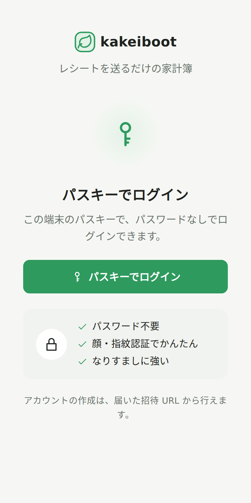
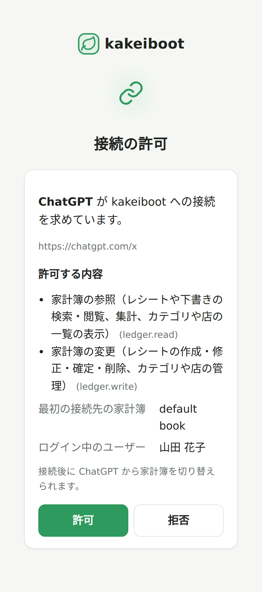

# 接続する

ChatGPT または Claude に kakeiboot を接続すると、会話でレシートを記録できます。最初に一度だけ接続が必要です。

```usage:connect-flow
caption: 接続の流れ: URLの登録、ブラウザでのログインと許可をへて、接続したアプリの会話でレシートを送れるようになります
```

## 1. 接続URLを登録する

下の URL をコピーして、使うアプリのコネクタ追加画面に登録します。登録はブラウザで行い、登録した接続は ChatGPT・Claude ともスマホアプリでも使えます。

```usage:connect-url
```

### ChatGPT に登録する

1. [ChatGPT を開く](https://chatgpt.com/) を押して、ChatGPT にログインします
2. 設定から「コネクター」（Apps & Connectors）を開きます
3. 「高度な設定」で開発者モードをオンにします（初回のみ）
4. 「コネクタを追加」で名前（例: kakeiboot）と、コピーした URL を入力します
5. 認証画面が開くので、次の手順でログインと許可を行います

```usage:figure-pending
id: fig-chatgpt-add
caption: ChatGPT のコネクタ追加画面
note: ここには ChatGPT のコネクタ追加画面とURL入力箇所のスクリーンショットを表示します（実機確認後に差し替え）
```

### Claude に登録する

1. [Claude を開く](https://claude.ai/) を押して、Claude にログインします
2. 「Customize」から「Connectors」を開きます
3. 「Add custom connector」で名前（例: kakeiboot）と、コピーした URL を入力します
4. 認証は「Use Claude's published identity」を選びます
5. 認証画面が開くので、次の手順でログインと許可を行います

```usage:figure-pending
id: fig-claude-add
caption: Claude のコネクタ追加画面
note: ここには Claude のコネクタ追加画面とURL入力箇所のスクリーンショットを表示します（実機確認後に差し替え）
```

## 2. ログインして接続を許可する

URL を入力すると、ブラウザでこのアプリの画面が開きます。ログインしていなければ「パスキーでログイン」を押します。表示された内容を確認して「許可」を押します。

許可する内容は次のとおりです。

- 家計簿の参照（レシートや下書きの検索・閲覧、集計、カテゴリや店の一覧の表示）
- 家計簿の変更（レシートの作成・修正・確定・削除、カテゴリや店の管理）
- 最初の接続先の家計簿（接続後に接続したアプリから切り替え可能）

接続のたびに（再接続時も）毎回この許可画面が出ます。





## 3. 会話でレシートを送る

接続したアプリに戻ると接続完了です。レシートの写真を貼って「これを登録して」のように送ります。読み取った内容の確認が会話に表示されるので、問題なければ登録してください。家計簿に記録されます。

詳しくは [レシートを送る](usage_send-receipt.md) を読んでください。

```usage:figure-pending
id: fig-conversation
caption: 会話でレシートを送る例
note: ここには会話でレシートの写真を送り、内容の確認を承認する様子のスクリーンショットを表示します（実機確認後に差し替え）
```

## 接続の有効期限

90日ごとに接続が切れます。切れたら同じ手順で再接続してください。

## 接続を管理する

[接続中のアプリ](/apps) で、接続の内容を確認できます。右上のアカウントメニューから開きます。

接続先の家計簿を切り替えるには、次の手順で操作します。

1. 「切り替え先の家計簿」を選びます
2. 「切り替え」を押します

会話で「家計簿を ○○ に切り替えて」と頼んでも切り替えられます。この切り替えはその接続でだけ有効で、web 画面の表示は変わりません。

接続を解除するには、「接続を解除」を押してから「解除する」を押します。解除すると、再度接続するまで利用できなくなります。

## うまくいかないとき

「この接続要求は無効か期限切れです」と出たら、接続元アプリの操作からもう一度やり直してください。

「この画面は埋め込み表示では利用できません」と出たら、ブラウザで直接開いてください。
